  

  
  
  
  

  <b>🇵🇹 Português</b> · <a href="#-english">🇬🇧 English</a>

<table align="center">
  <tr>
    <td align="center" width="25%"><b>🏆 Technical Excellence Award</b> PRIMAVERA · 2019</td>
    <td align="center" width="25%"><b>⏳ 17+ anos</b> de integração e automação</td>
    <td align="center" width="25%"><b>🟢 2 produtos</b> em produção pública</td>
    <td align="center" width="25%"><b>🔐 IA privada</b> on-prem · chave própria (BYOK)</td>
  </tr>
</table>

---

### Resolvemos os processos difíceis

Com ou sem IA, o objetivo é o mesmo: **sistemas fiáveis que devolvem tempo às equipas**. Integramos ERP, banca e dados, automatizamos workflows e pomos IA a trabalhar — em produção, não em slides.

### 🚀 Produtos

<table>
  <tr>
    <td width="33%" valign="top">
      <h4>🤖 <a href="https://github.com/BolaLabs/AITOOL">AITOOL para Primavera</a></h4>
      ERP · IA APLICADA  
      Assistente de IA dentro do ERP Primavera: pergunta, preenche janelas, cria documentos, recibos e aprovações. Corre em máquinas que controla. <b>Nada é gravado sem o seu clique.</b>  
       
      <a href="https://bolalabs.pt/pt/aitool">Página do produto →</a>
    </td>
    <td width="33%" valign="top">
      <h4>🏛️ <a href="https://github.com/brunobola-portfolio/community-platform">Community Platform</a></h4>
      PORTAIS · IA  
      Plataforma open source para associações, comunidades e instituições: sócios, eventos, quotas, notícias e um assistente de IA, gerida pela direção no seu próprio backoffice.  
       
      <a href="https://bolalabs.pt/pt/community-platform">Página do produto →</a>
    </td>
    <td width="33%" valign="top">
      <h4>🧭 <a href="https://github.com/brunobola-portfolio/GitHub-Repo-Manager">GitHub Repo Manager</a></h4>
      DEVTOOLS · IA  
      Um dashboard para repositórios, Work Board entre repositórios, AI Deep Review e migração Azure DevOps → GitHub.  
       
      <a href="https://bolalabs.pt/pt/repomanager">Página do produto →</a>
    </td>
  </tr>
</table>

### 🧩 Capacidades

<table>
  <tr>
    <td width="33%" valign="top">⚙️ <b>Automação de processos</b> Workflows, armazéns e logística.</td>
    <td width="33%" valign="top">🔌 <b>Integração de APIs &amp; sistemas</b> ERP, banca (MB WAY/SIBS), dados.</td>
    <td width="33%" valign="top">📊 <b>Dashboards analíticos</b> Decidir com dados.</td>
  </tr>
  <tr>
    <td width="33%" valign="top">🔐 <b>IA local e privada</b> Chave própria, nos seus servidores.</td>
    <td width="33%" valign="top">🌐 <b>Portais &amp; web apps</b> Do backoffice ao público.</td>
    <td width="33%" valign="top">⚡ <b>Dados &amp; performance SQL</b> Consultas até 70% mais rápidas.</td>
  </tr>
</table>

### 🧠 IA em produção, hoje

- **RAG em produção** num cliente ([arcva.pt](https://arcva.pt)), com guardrails.
- **Multi-provider sem lock-in** — OpenAI, Anthropic, Gemini, OpenRouter e modelos locais, BYOK.
- **IA privada on-prem** para dados sensíveis.

  
  
  
  
  
  
  
  
  

  <b>Tem um processo que devia estar resolvido?</b> 
  Trinta minutos para perceber o problema e dizer-lhe, com honestidade, se e como o resolvemos.  
  

---

### 🇬🇧 English

**BolaLabs solves the hard processes.** With or without AI, the goal is the same: reliable systems that give teams their time back — ERP, banking and data integrations, workflow automation, analytics dashboards, SQL performance and private, on-prem AI. Running in production, not in slides.

- 🤖 **[AITOOL for Primavera](https://github.com/BolaLabs/AITOOL)** — an AI assistant inside the Primavera ERP, on machines you control. Nothing is saved without your click.
- 🏛️ **[Community Platform](https://github.com/brunobola-portfolio/community-platform)** — open-source platform for associations and institutions, in production at arcva.pt.
- 🧭 **[GitHub Repo Manager](https://github.com/brunobola-portfolio/GitHub-Repo-Manager)** — one dashboard for repositories, a cross-repo Work Board, AI Deep Review and Azure DevOps → GitHub migration.

Multi-provider AI with no lock-in (OpenAI, Anthropic, Gemini, OpenRouter, local models — BYOK). → **[Book a free 30-minute diagnosis](https://bolalabs.pt/pt/contact)**

---

  Led by <a href="https://github.com/brunobola-portfolio"><b>Bruno Silva Marques</b></a> · part of <a href="https://elevatingsolutions.pt">Elevating Solutions</a> · <a href="https://bolalabs.pt">bolalabs.pt</a> · <a href="https://bolalabs.pt/pt/privacy">Privacidade</a>

